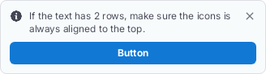

# AlertBox / InfoBox

Use `KlikInfoBox` or `PoinkuAlertBox` for product recipes. `CoreAlertBox` supplies shared message, action, and accessibility behavior in a Material-compatible theme.

## XML

```xml
<id.co.edtslib.uikit.recipes.alertbox.klik.KlikInfoBox
    xmlns:android="http://schemas.android.com/apk/res/android"
    xmlns:app="http://schemas.android.com/apk/res-auto"
    style="@style/Widget.EDTS.UIKit.AlertBox.Klik.Border.Info"
    android:layout_width="match_parent"
    android:layout_height="wrap_content"
    app:text="@string/promotion_notice"
    app:isButtonVisible="true"
    app:buttonText="@string/continue_label" />
```

Choose a recipe through XML `style`, `app:alertRecipe`, or Kotlin `alertRecipe`. Explicit XML attributes override recipe values during inflation; assigning a recipe later replaces appearance overrides.

## Recipes

| Product | Style prefix | Variants |
|---|---|---|
| Klik bordered | `Widget.EDTS.UIKit.AlertBox.Klik.Border` | `General`, `Info`, `Success`, `Error`, `Warning` |
| Klik full width | `Widget.EDTS.UIKit.AlertBox.Klik.FullWidth` | `General` |
| Poinku | `Widget.EDTS.UIKit.AlertBox.Poinku` | `Info`, `Success`, `Error`, `Warning` |

Klik defaults to bordered General; Poinku defaults to Info. Both support optional close and footer actions.

| Klik | Poinku |
|---|---|
|  |  |

## Content and actions

```kotlin
import android.view.View
import id.co.edtslib.uikit.alert.AlertBoxDelegate
import id.co.edtslib.uikit.R as UIKitR

binding.infoBox.apply {
    alertRecipe = UIKitR.style.Widget_EDTS_UIKit_AlertBox_Klik_Border_Success
    text = message
    actionText = "Edit"
    isActionVisible = true
    delegate = object : AlertBoxDelegate {
        override fun onCloseClickListener(view: View) {
            visibility = View.GONE
        }

        override fun onButtonClickListener(view: View) = onContinue()
        override fun onActionClickListener(view: View) = onEdit()
    }
}
```


| API | Purpose |
|---|---|
| `text: CharSequence`, `isHtml` | Plain/spanned text, or backend HTML with shared parsing and emphasis handling. |
| `isStartIconVisible`, `isCloseIconVisible` | Show/hide icon slots. Product recipes choose the severity glyph and tint. |
| `buttonText`, `isButtonVisible` | Footer action, delivered through `onButtonClickListener`. |
| `actionText`, `isActionVisible` | Inline action, delivered through `onActionClickListener`. |
| `actionEndIcon`, `actionEndIconTint`, `actionIconPadding` | Optional trailing inline-action icon; padding is in pixels. |
| `actionMaxLines`, `actionEllipsize` | Inline-label wrapping/truncation; defaults to one line with end ellipsis. |
| `iconAlignment` | `CoreAlertBox.IconAlignment.TOP`, `CENTER`, or `BOTTOM`; default is Top. |
| `isEnabled` | New entry points disable their message links and action controls together. |

For backend HTML, set `isHtml = true`. The shared renderer preserves entities, links, lists, and repeated `<b>`/`<strong>` ranges. Product emphasis uses the recipe's font; existing `buildHighlightedMessage` overloads remain available for screen-owned inline emphasis/actions.

## Legacy migration

`id.co.edtslib.uikit.alert.AlertBox` remains a deprecated compatibility entry point. Its constructors, properties, delegate callbacks, enum/XML numeric values, resource names, default appearance, and `showOpticalSpacing()` API remain available. Existing XML resources and layout are retained.

Map legacy `SUCCESS`, `ERROR`, `WARNING`, and `INFO` to an explicit product recipe with the matching suffix. Legacy `LIGHT` maps to Klik `Border.General`; Poinku has no General counterpart.
