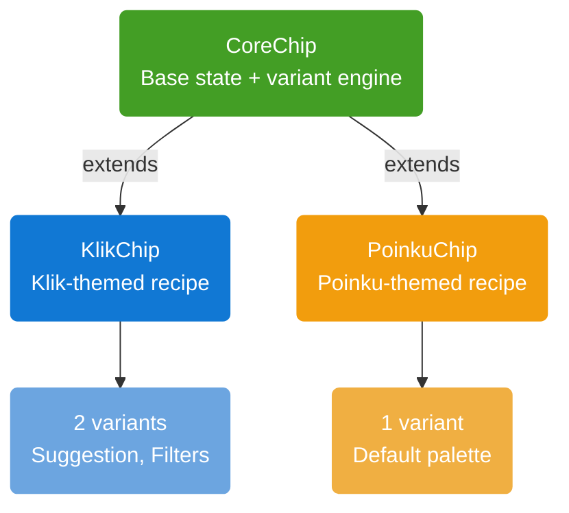
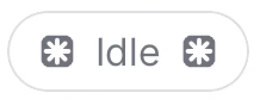
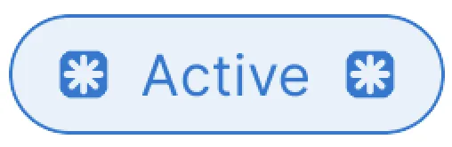
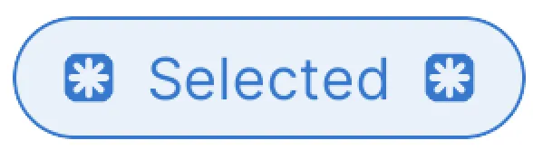

# Chip

`Chip` is a interactive component for filters, tags, suggestions, and other selectable or actionable labels. `CoreChip` is the base implementation, exposes set of variants tailored to that product. Currently available recipes are **Klik** (`KlikChip`) and **Poinku** (`PoinkuChip`).

## Architecture



| Class                 | Role                                                                                                                                                |
|-----------------------|-----------------------------------------------------------------------------------------------------------------------------------------------------|
| `ChipPreset`          | Geometry for a variant: corner radius, border width, text appearance, padding, and an optional relative `widthPercent`.                             |
| `ChipPalette`         | Colors for a single state: background, text, start/end icon colors, border color, icon background colors + visibility, icon padding, or a gradient. |
| `ChipVariant`         | Combines `ChipPreset` and `ChipPalette` for each state of chip                                                                                      |
| `ChipStateAnnotation` | `@IntDef` restricting the `state` property to `CHIP_STATE_IDLE` (0), `CHIP_STATE_SELECTED` (1), or `CHIP_STATE_ACTIVE` (2).                         |
| `ChipDelegate`        | Callback interface for chip taps: `onClick`, and optional `onStartIconClick` / `onEndIconClick` for actionable icons.                               |

## CoreChip


`CoreChip` is the base component that Klik and Poinku chips are built on.

### Features

- **State-driven palette**: `state` (idle/active/selected) automatically selects the right `ChipPalette` from the active `ChipVariant`, falling back to the idle palette for any state that isn't explicitly defined.
- **Gradient or solid backgrounds**: A variant's palette can specify a solid `backgroundColorRes` or multi-color `gradientColors` + orientation.
- **Relative width**: A variant's preset can set `widthPercent` to size the chip as a fraction of the device width; omitted, the chip sizes to its content (`wrap_content`).
- **Extensible**: New products add a recipe package (`Variant` + a themed `Chip` subclass) without modifying `CoreChip`.

### Chip States

| State                 | Int Value | Description                                                                                                                    |
|-----------------------|:---------:|--------------------------------------------------------------------------------------------------------------------------------|
| `CHIP_STATE_IDLE`     |    `0`    | Default, resting state. Always has a defined palette (`idlePalette`).                                                          |
| `CHIP_STATE_SELECTED` |    `1`    | The chip has been selected (e.g. a toggled filter). Falls back to `idlePalette` if a variant doesn't define `selectedPalette`. |
| `CHIP_STATE_ACTIVE`   |    `2`    | The chip is actively pressed/engaged. Falls back to `idlePalette` if a variant doesn't define `activePalette`.                 |


### Properties

| Property                         | Type                           | Default Value     | Description                                                                                   |
|----------------------------------|--------------------------------|-------------------|-----------------------------------------------------------------------------------------------|
| `text`                           | `String?`                      | `null`            | The chip's label.                                                                             |
| `chipColor`                      | `Int?` (`@ColorInt`)           | `null`            | Overrides the background color from the active palette. Also clears any gradient background.  |
| `chipTextColor`                  | `Int?` (`@ColorInt`)           | `null`            | Overrides the text color from the active palette.                                             |
| `chipStartIconColor`             | `Int?` (`@ColorInt`)           | `null`            | Overrides the start icon tint from the active palette.                                        |
| `chipEndIconColor`               | `Int?` (`@ColorInt`)           | `null`            | Overrides the end icon tint from the active palette.                                          |
| `chipBorderColor`                | `Int?` (`@ColorInt`)           | `null`            | Overrides the border color from the active palette.                                           |
| `chipStartIconBackgroundColor`   | `Int?` (`@ColorInt`)           | `null`            | Overrides the start icon's background circle color.                                           |
| `chipEndIconBackgroundColor`     | `Int?` (`@ColorInt`)           | `null`            | Overrides the end icon's background circle color.                                             |
| `chipCornerRadius`               | `Float?`                       | `null`            | Fixed corner radius (dp). `null` keeps the auto pill radius (half the chip's height).         |
| `chipBorderWidth`                | `Int?`                         | `null`            | Overrides the border width (dp) from the active preset.                                       |
| `chipTextAppearance`             | `Int?` (`@StyleRes`)           | `null`            | Overrides the text appearance from the active preset.                                         |
| `isStartIconVisible`             | `Boolean`                      | `false`           | Shows or hides the start icon.                                                                |
| `isEndIconVisible`               | `Boolean`                      | `false`           | Shows or hides the end icon.                                                                  |
| `chipStartIconBackgroundVisible` | `Boolean?`                     | `null`            | Overrides whether the start icon shows its background circle. `null` defers to the palette.   |
| `chipEndIconBackgroundVisible`   | `Boolean?`                     | `null`            | Overrides whether the end icon shows its background circle. `null` defers to the palette.     |
| `isStartIconActionable`          | `Boolean`                      | `false`           | Makes the start icon independently tappable (ripple + `onStartIconClick`).                    |
| `isEndIconActionable`            | `Boolean`                      | `false`           | Makes the end icon independently tappable (ripple + `onEndIconClick`).                        |
| `delegate`                       | `ChipDelegate?`                | `null`            | Callback target for chip / icon taps.                                                         |
| `state`                          | `Int` (`@ChipStateAnnotation`) | `CHIP_STATE_IDLE` | The chip's current interaction state; drives which palette is applied.                        |
| `chipCard`                       | `View`                         | —                 | The inner card container view, exposed for advanced customization.                            |
| `chipVariant` *(protected)*      | `ChipVariant?`                 | `CoreChipVariant` | The active variant; setting it applies the preset and re-derives the current state's palette. |

### Methods

| Method                                  | Description                                                                |
|-----------------------------------------|----------------------------------------------------------------------------|
| `setStartIcon(@DrawableRes resId: Int)` | Sets the start icon drawable (automatically inset for consistent padding). |
| `setEndIcon(@DrawableRes resId: Int)`   | Sets the end icon drawable (automatically inset for consistent padding).   |

### XML Attributes

Attributes actually read by `CoreChip` on inflation:

| Attribute                  | Type                            | Description                                                                                                          |
|----------------------------|---------------------------------|----------------------------------------------------------------------------------------------------------------------|
| `text`                     | `string`                        | Chip label text.                                                                                                     |
| `chipColor`                | `color`                         | Background color override. Takes priority over `backgroundColor`.                                                    |
| `backgroundColor`          | `color`                         | Fallback background color override if `chipColor` isn't set.                                                         |
| `textColor`                | `color`                         | Text color override.                                                                                                 |
| `startIconSize`            | `dimension`                     | Start icon size override.                                                                                            |
| `endIconSize`              | `dimension`                     | End icon size override.                                                                                              |
| `startIconColor`           | `color`                         | Start icon tint override.                                                                                            |
| `endIconColor`             | `color`                         | End icon tint override.                                                                                              |
| `strokeColor`              | `color`                         | Border color override (maps to `chipBorderColor`).                                                                   |
| `strokeWidth`              | `dimension`                     | Border width override (maps to `chipBorderWidth`).                                                                   |
| `cornerRadius`             | `dimension`                     | Fixed corner radius override (maps to `chipCornerRadius`).                                                           |
| `textAppearance`           | `reference (style)`             | Text appearance override.                                                                                            |
| `startIconBackgroundColor` | `color`                         | Start icon background circle color override.                                                                         |
| `endIconBackgroundColor`   | `color`                         | End icon background circle color override.                                                                           |
| `isStartIconVisible`       | `boolean`                       | Shows or hides the start icon.                                                                                       |
| `isEndIconVisible`         | `boolean`                       | Shows or hides the end icon.                                                                                         |
| `isStartIconActionable`    | `boolean`                       | Makes the start icon independently tappable.                                                                         |
| `isEndIconActionable`      | `boolean`                       | Makes the end icon independently tappable.                                                                           |
| `startIcon`                | `reference (drawable)`          | Start icon drawable.                                                                                                 |
| `endIcon`                  | `reference (drawable)`          | End icon drawable.                                                                                                   |
| `chipState`                | `enum (idle, selected, active)` | Initial interaction state (`idle=0`, `selected=1`, `active=2`), matching `ChipStateAnnotation`.                      |
| `chipVariant`              | `reference (style)`             | Read by each recipe (`KlikChip`, `PoinkuChip`), not by `CoreChip` itself, to resolve the recipe's own `ChipVariant`. |


### Usage

```xml
<id.co.edtslib.uikit.recipes.chip.klik.KlikChip
    android:id="@+id/chipFilter"
    android:layout_width="wrap_content"
    android:layout_height="wrap_content"
    app:chipVariant="@style/Widget.EDTS.UIKit.Chip.Klik.Filters"
    app:text="Price"
    app:isEndIconVisible="true"
    app:endIcon="@drawable/ic_chevron_down"/>
```

```kotlin
chipFilter.delegate = object : ChipDelegate {
    override fun onClick(view: View, state: Int) {
        chipFilter.state = if (state == CHIP_STATE_IDLE) CHIP_STATE_SELECTED else CHIP_STATE_IDLE
    }
}
```

## Klik Chip

`KlikChip` exposes two variants: **Suggestion** and **Filters**. Each configured with its own idle, active, and selected palettes.

| Variant        | Description                                                                                                                                                               | Style Resource                           | Kotlin Variant               | Idle Preview                                              | Active Preview                                                | Selected Preview                                                  |
|----------------|---------------------------------------------------------------------------------------------------------------------------------------------------------------------------|------------------------------------------|------------------------------|-----------------------------------------------------------|---------------------------------------------------------------|-------------------------------------------------------------------|
| **Suggestion** | The default Klik chip. A filled grey pill that turns solid blue with white text/icons once active or selected. No border. Ideal for suggested tags or quick-pick options. | `Widget.EDTS.UIKit.Chip.Klik.Suggestion` | `KlikChipVariant.Suggestion` |  |  |  |
| **Filters**    | An outlined white pill with a grey border, switching to a light-blue background with a blue border/text once active or selected. Ideal for filter chips.                  | `Widget.EDTS.UIKit.Chip.Klik.Filters`    | `KlikChipVariant.Filters`    |        |        |        |

**Implementation**:
```xml
<id.co.edtslib.uikit.recipes.chip.klik.KlikChip
    android:id="@+id/chipSuggestion"
    android:layout_width="wrap_content"
    android:layout_height="wrap_content"
    app:chipVariant="@style/Widget.EDTS.UIKit.Chip.Klik.Suggestion"
    app:text="Nearby"/>
```
Or set the variant at runtime:
```kotlin
klikChip.klikChipVariant = KlikChipVariant.Filters
klikChip.text = "Category"
```

## Poinku Chip

`PoinkuChip` ships a single variant (`PoinkuChipVariant`) with a light grey idle state, a soft-blue active state, and a solid blue selected state — all with a matching 1dp border.

| Variant     | Description                                                                                                                        | Style Resource                  | Kotlin Variant      | Idle Preview                                          | Active Preview                                            | Selected Preview                                              |
|-------------|------------------------------------------------------------------------------------------------------------------------------------|---------------------------------|---------------------|-------------------------------------------------------|-----------------------------------------------------------|---------------------------------------------------------------|
| **Default** | A bordered grey pill that highlights to a soft-blue outline when active, and fills solid blue with white text/icons when selected. | `Widget.EDTS.UIKit.Chip.Poinku` | `PoinkuChipVariant` |  |  |  |

**Implementation**:
```xml
<id.co.edtslib.uikit.recipes.chip.poinku.PoinkuChip
    android:id="@+id/chipTag"
    android:layout_width="wrap_content"
    android:layout_height="wrap_content"
    app:text="Groceries"/>
```