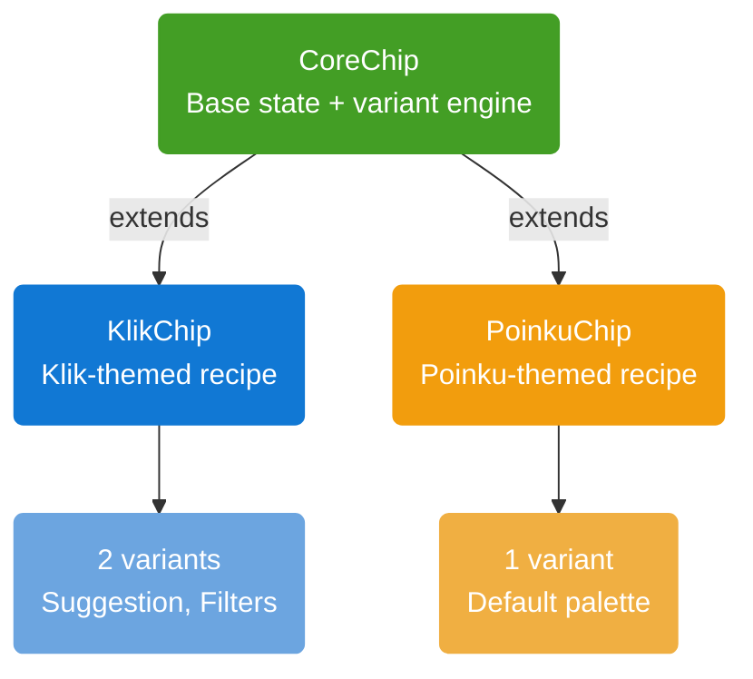
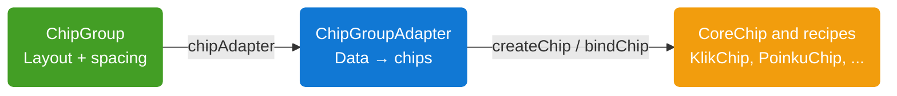

# Chip

`Chip` is a interactive component for filters, tags, suggestions, and other selectable or actionable labels. `CoreChip` is the base implementation, exposes set of variants tailored to that product. Currently available recipes are **Klik** (`KlikChip`) and **Poinku** (`PoinkuChip`). Chips can be laid out as a list, wrapping flow, or grid with **Chip Group** (`ChipGroup`).

## Architecture



### Chip

| Class                 | Role                                                                                                                                                |
|-----------------------|-----------------------------------------------------------------------------------------------------------------------------------------------------|
| `ChipPreset`          | Geometry for a variant: corner radius, border width, text appearance, padding, and an optional relative `widthPercent`.                             |
| `ChipPalette`         | Colors for a single state: background, text, start/end icon colors, border color, icon background colors + visibility, icon padding, or a gradient. |
| `ChipVariant`         | Combines `ChipPreset` and `ChipPalette` for each state of chip                                                                                      |
| `ChipStateAnnotation` | `@IntDef` restricting the `state` property to `CHIP_STATE_IDLE` (0), `CHIP_STATE_SELECTED` (1), or `CHIP_STATE_ACTIVE` (2).                         |
| `ChipDelegate`        | Callback interface for chip taps: `onClick`, and optional `onStartIconClick` / `onEndIconClick` for actionable icons.                               |




### Chip Group

| Class               | Role                                                                                                                                                      |
|---------------------|-----------------------------------------------------------------------------------------------------------------------------------------------------------|
| `ChipGroup`         | `RecyclerView`-based container that lays out chips horizontally, vertically, or in a (wrapping / fixed-column) grid, with item spacing and group padding. |
| `ChipGroupAdapter`  | Drives a `ChipGroup` from any list of data. Chip-agnostic: works with `CoreChip`, `KlikChip`, `PoinkuChip`, or any future recipe.                         |
| `ChipGroupDelegate` | Callback interface for taps on a group's chips: which chip, which item, which position.                                                                   |


## CoreChip


`CoreChip` is the base component that Klik and Poinku chips are built on.

### Features

- **State-driven palette**: `state` (idle/active/selected) automatically selects the right `ChipPalette` from the active `ChipVariant`, falling back to the idle palette for any state that isn't explicitly defined.
- **Gradient or solid backgrounds**: A variant's palette can specify a solid `backgroundColorRes` or multi-color `gradientColors` + orientation.
- **Relative width**: A variant's preset can set `widthPercent` to size the chip as a fraction of the device width; omitted, the chip sizes to its content (`wrap_content`).
- **Extensible**: New products add a recipe package (`Variant` + a themed `Chip` subclass) without modifying `CoreChip`.

### Chip States

| State                 | Int Value | Description                                                                                                                    |
|-----------------------|:---------:|--------------------------------------------------------------------------------------------------------------------------------|
| `CHIP_STATE_IDLE`     |    `0`    | Default, resting state. Always has a defined palette (`idlePalette`).                                                          |
| `CHIP_STATE_SELECTED` |    `1`    | The chip has been selected (e.g. a toggled filter). Falls back to `idlePalette` if a variant doesn't define `selectedPalette`. |
| `CHIP_STATE_ACTIVE`   |    `2`    | The chip is actively pressed/engaged. Falls back to `idlePalette` if a variant doesn't define `activePalette`.                 |


### Properties

| Property                         | Type                           | Default Value     | Description                                                                                   |
|----------------------------------|--------------------------------|-------------------|-----------------------------------------------------------------------------------------------|
| `text`                           | `String?`                      | `null`            | The chip's label.                                                                             |
| `chipColor`                      | `Int?` (`@ColorInt`)           | `null`            | Overrides the background color from the active palette. Also clears any gradient background.  |
| `chipTextColor`                  | `Int?` (`@ColorInt`)           | `null`            | Overrides the text color from the active palette.                                             |
| `chipStartIconColor`             | `Int?` (`@ColorInt`)           | `null`            | Overrides the start icon tint from the active palette.                                        |
| `chipEndIconColor`               | `Int?` (`@ColorInt`)           | `null`            | Overrides the end icon tint from the active palette.                                          |
| `chipBorderColor`                | `Int?` (`@ColorInt`)           | `null`            | Overrides the border color from the active palette.                                           |
| `chipStartIconBackgroundColor`   | `Int?` (`@ColorInt`)           | `null`            | Overrides the start icon's background circle color.                                           |
| `chipEndIconBackgroundColor`     | `Int?` (`@ColorInt`)           | `null`            | Overrides the end icon's background circle color.                                             |
| `chipCornerRadius`               | `Float?`                       | `null`            | Fixed corner radius (dp). `null` keeps the auto pill radius (half the chip's height).         |
| `chipBorderWidth`                | `Int?`                         | `null`            | Overrides the border width (dp) from the active preset.                                       |
| `chipTextAppearance`             | `Int?` (`@StyleRes`)           | `null`            | Overrides the text appearance from the active preset.                                         |
| `isStartIconVisible`             | `Boolean`                      | `false`           | Shows or hides the start icon.                                                                |
| `isEndIconVisible`               | `Boolean`                      | `false`           | Shows or hides the end icon.                                                                  |
| `chipStartIconBackgroundVisible` | `Boolean?`                     | `null`            | Overrides whether the start icon shows its background circle. `null` defers to the palette.   |
| `chipEndIconBackgroundVisible`   | `Boolean?`                     | `null`            | Overrides whether the end icon shows its background circle. `null` defers to the palette.     |
| `isStartIconActionable`          | `Boolean`                      | `false`           | Makes the start icon independently tappable (ripple + `onStartIconClick`).                    |
| `isEndIconActionable`            | `Boolean`                      | `false`           | Makes the end icon independently tappable (ripple + `onEndIconClick`).                        |
| `delegate`                       | `ChipDelegate?`                | `null`            | Callback target for chip / icon taps.                                                         |
| `state`                          | `Int` (`@ChipStateAnnotation`) | `CHIP_STATE_IDLE` | The chip's current interaction state; drives which palette is applied.                        |
| `chipCard`                       | `View`                         | —                 | The inner card container view, exposed for advanced customization.                            |
| `chipVariant` *(protected)*      | `ChipVariant?`                 | `CoreChipVariant` | The active variant; setting it applies the preset and re-derives the current state's palette. |

### Methods

| Method                                  | Description                                                                |
|-----------------------------------------|----------------------------------------------------------------------------|
| `setStartIcon(@DrawableRes resId: Int)` | Sets the start icon drawable (automatically inset for consistent padding). |
| `setEndIcon(@DrawableRes resId: Int)`   | Sets the end icon drawable (automatically inset for consistent padding).   |

### XML Attributes

Attributes actually read by `CoreChip` on inflation:

| Attribute                  | Type                            | Description                                                                                                          |
|----------------------------|---------------------------------|----------------------------------------------------------------------------------------------------------------------|
| `text`                     | `string`                        | Chip label text.                                                                                                     |
| `chipColor`                | `color`                         | Background color override. Takes priority over `backgroundColor`.                                                    |
| `backgroundColor`          | `color`                         | Fallback background color override if `chipColor` isn't set.                                                         |
| `textColor`                | `color`                         | Text color override.                                                                                                 |
| `startIconSize`            | `dimension`                     | Start icon size override.                                                                                            |
| `endIconSize`              | `dimension`                     | End icon size override.                                                                                              |
| `startIconColor`           | `color`                         | Start icon tint override.                                                                                            |
| `endIconColor`             | `color`                         | End icon tint override.                                                                                              |
| `strokeColor`              | `color`                         | Border color override (maps to `chipBorderColor`).                                                                   |
| `strokeWidth`              | `dimension`                     | Border width override (maps to `chipBorderWidth`).                                                                   |
| `cornerRadius`             | `dimension`                     | Fixed corner radius override (maps to `chipCornerRadius`).                                                           |
| `textAppearance`           | `reference (style)`             | Text appearance override.                                                                                            |
| `startIconBackgroundColor` | `color`                         | Start icon background circle color override.                                                                         |
| `endIconBackgroundColor`   | `color`                         | End icon background circle color override.                                                                           |
| `isStartIconVisible`       | `boolean`                       | Shows or hides the start icon.                                                                                       |
| `isEndIconVisible`         | `boolean`                       | Shows or hides the end icon.                                                                                         |
| `isStartIconActionable`    | `boolean`                       | Makes the start icon independently tappable.                                                                         |
| `isEndIconActionable`      | `boolean`                       | Makes the end icon independently tappable.                                                                           |
| `startIcon`                | `reference (drawable)`          | Start icon drawable.                                                                                                 |
| `endIcon`                  | `reference (drawable)`          | End icon drawable.                                                                                                   |
| `chipState`                | `enum (idle, selected, active)` | Initial interaction state (`idle=0`, `selected=1`, `active=2`), matching `ChipStateAnnotation`.                      |
| `chipVariant`              | `reference (style)`             | Read by each recipe (`KlikChip`, `PoinkuChip`), not by `CoreChip` itself, to resolve the recipe's own `ChipVariant`. |


### Usage

```xml
<id.co.edtslib.uikit.recipes.chip.klik.KlikChip
    android:id="@+id/chipFilter"
    android:layout_width="wrap_content"
    android:layout_height="wrap_content"
    app:chipVariant="@style/Widget.EDTS.UIKit.Chip.Klik.Filters"
    app:text="Price"
    app:isEndIconVisible="true"
    app:endIcon="@drawable/ic_chevron_down"/>
```

```kotlin
chipFilter.delegate = object : ChipDelegate {
    override fun onClick(view: View, state: Int) {
        chipFilter.state = if (state == CHIP_STATE_IDLE) CHIP_STATE_SELECTED else CHIP_STATE_IDLE
    }
}
```

## Klik Chip

`KlikChip` exposes two variants: **Suggestion** and **Filters**. Each configured with its own idle, active, and selected palettes.

| Variant        | Description                                                                                                                                                               | Style Resource                           | Kotlin Variant               | Idle Preview                                              | Active Preview                                                | Selected Preview                                                  |
|----------------|---------------------------------------------------------------------------------------------------------------------------------------------------------------------------|------------------------------------------|------------------------------|-----------------------------------------------------------|---------------------------------------------------------------|-------------------------------------------------------------------|
| **Suggestion** | The default Klik chip. A filled grey pill that turns solid blue with white text/icons once active or selected. No border. Ideal for suggested tags or quick-pick options. | `Widget.EDTS.UIKit.Chip.Klik.Suggestion` | `KlikChipVariant.Suggestion` |  |  |  |
| **Filters**    | An outlined white pill with a grey border, switching to a light-blue background with a blue border/text once active or selected. Ideal for filter chips.                  | `Widget.EDTS.UIKit.Chip.Klik.Filters`    | `KlikChipVariant.Filters`    |        |        |        |

**Implementation**:
```xml
<id.co.edtslib.uikit.recipes.chip.klik.KlikChip
    android:id="@+id/chipSuggestion"
    android:layout_width="wrap_content"
    android:layout_height="wrap_content"
    app:chipVariant="@style/Widget.EDTS.UIKit.Chip.Klik.Suggestion"
    app:text="Nearby"/>
```
Or set the variant at runtime:
```kotlin
klikChip.klikChipVariant = KlikChipVariant.Filters
klikChip.text = "Category"
```

## Poinku Chip

`PoinkuChip` ships a single variant (`PoinkuChipVariant`) with a light grey idle state, a soft-blue active state, and a solid blue selected state — all with a matching 1dp border.

| Variant     | Description                                                                                                                        | Style Resource                  | Kotlin Variant      | Idle Preview                                          | Active Preview                                            | Selected Preview                                              |
|-------------|------------------------------------------------------------------------------------------------------------------------------------|---------------------------------|---------------------|-------------------------------------------------------|-----------------------------------------------------------|---------------------------------------------------------------|
| **Default** | A bordered grey pill that highlights to a soft-blue outline when active, and fills solid blue with white text/icons when selected. | `Widget.EDTS.UIKit.Chip.Poinku` | `PoinkuChipVariant` |  |  |  |

**Implementation**:
```xml
<id.co.edtslib.uikit.recipes.chip.poinku.PoinkuChip
    android:id="@+id/chipTag"
    android:layout_width="wrap_content"
    android:layout_height="wrap_content"
    app:text="Groceries"/>
```

## Chip Group


`ChipGroup` shows a list of chips in one of three layouts. It extends `RecyclerView`, so chips are recycled and the list can scroll.

### Orientations

| `ChipGroupOrientation` | `app:orientation` | `spanCount` | Layout                                                                                                                                                                                                                |
|------------------------|-------------------|-------------|-----------------------------------------------------------------------------------------------------------------------------------------------------------------------------------------------------------------------|
| `HORIZONTAL` (default) | `horizontal`      | ignored     | A single scrollable row. Chips keep their natural width.                                                                                                                                                              |
| `VERTICAL`             | `vertical`        | ignored     | A single column.                                                                                                                                                                                                      |
| `GRID`                 | `grid`            | `null`      | When value is 'null' chips on **Wrap Mode** where chips keep their natural width and flow onto a new line when the row is full. When value is `>= 1` chips on **Fixed Span Mode** with that many equal-width columns. |


### Properties

| Property                | Type                     | Default      | Description                                                                                                                 |
|-------------------------|--------------------------|--------------|-----------------------------------------------------------------------------------------------------------------------------|
| `orientation`           | `ChipGroupOrientation`   | `HORIZONTAL` | Layout mode. Changing it swaps the `LayoutManager` and keeps the adapter attached.                                          |
| `spanCount`             | `Int?`                   | `null`       | Only used when `orientation` is `GRID`. `null` = wrapping grid; `>= 1` = fixed columns. Values `< 1` are treated as `null`. |
| `selectionMode`         | `ChipGroupSelectionMode` | `MULTIPLE`   | `SINGLE` or `MULTIPLE`                                                                                                      |
| `itemSpacingHorizontal` | `Int` (px)               | `0`          | Gap between chips on the horizontal axis: trailing gap in `HORIZONTAL`, column gap in `GRID`. Ignored in `VERTICAL`.        |
| `itemSpacingVertical`   | `Int` (px)               | `0`          | Gap between chips on the vertical axis: trailing gap in `VERTICAL`, row gap in `GRID`. Ignored in `HORIZONTAL`.             |
| `groupPaddingStart`     | `Int` (px)               | `0`          | Padding start around the whole group at runtime.                                                                            |
| `groupPaddingTop`       | `Int` (px)               | `0`          | Padding top around the whole group at runtime.                                                                              |
| `groupPaddingEnd`       | `Int` (px)               | `0`          | Padding end around the whole group at runtime.                                                                              |
| `groupPaddingBottom`    | `Int` (px)               | `0`          | Padding bottom around the whole group at runtime.                                                                           |
| `groupPadding`          | `Int` (px)               | `0`          | Sets all four sides at once. Reading it returns the last value assigned here, not a value derived from the four sides.      |
| `chipAdapter`           | `ChipGroupAdapter<*>?`   | `null`       | The adapter that supplies the chips.                                                                                        |


### XML Attributes

| Attribute               | Type                                  | Description                                                                                  |
|-------------------------|---------------------------------------|----------------------------------------------------------------------------------------------|
| `orientation`           | `enum (horizontal, vertical, grid)`   | Layout mode (`horizontal=0`, `vertical=1`, `grid=2`).                                        |
| `selectionMode`         | `enum (single, multiple)`             | Selection behavior (`single=0`, `multiple=1`).                                               |
| `spanCount`             | `integer`                             | Fixed column count for `grid`. Omit for a wrapping grid.                                     |
| `itemSpacingHorizontal` | `dimension`                           | Horizontal gap between chips.                                                                |
| `itemSpacingVertical`   | `dimension`                           | Vertical gap between chips.                                                                  |

Group padding needs no custom attribute. Use the standard `android:padding*` attributes, and add `android:clipToPadding="false"` if chips should stay visible under the padding while scrolling.

### ChipGroupAdapter

`ChipGroupAdapter<T : Any>` binds a list of `T` to chips.

| Constructor parameter | Type                                               | Default      | Description                                                                                       |
|-----------------------|----------------------------------------------------|--------------|---------------------------------------------------------------------------------------------------|
| `createChip`          | `(parent: ViewGroup) -> CoreChip`                  | required     | Creates one chip. Return any `CoreChip` subclass (set its variant here).                          |
| `bindChip`            | `(chip: CoreChip, item: T, position: Int) -> Unit` | required     | Applies an item's data to a chip (`text`, `state`, icons, ...).                                   |
| `areItemsTheSame`     | `(old: T, new: T) -> Boolean`                      | `old == new` | Identity check for `DiffUtil`. Override with a stable id when equality isn't a reliable identity. |
| `areContentsTheSame`  | `(old: T, new: T) -> Boolean`                      | `old == new` | Decides whether a chip needs re-binding.                                                          |
| `isSelected`          | `(item: T) -> Boolean`                             | `{ false }`  | Tells the adapter which items count as selected, used by `selectedItems()`.                       |
| `delegate`            | `ChipGroupDelegate<T>?`                            | `null`       | Click callbacks. Also a `var`, so it can be set later.                                            |

| Method                     | Description                                                                                                           |
|----------------------------|-----------------------------------------------------------------------------------------------------------------------|
| `submitList(List<T>)`      | Replaces the list, diffing against the current one so only changed chips are re-bound. Runs on the calling thread.    |
| `currentList()`            | The list currently shown.                                                                                             |
| `selectedItems()`          | Items for which `isSelected` returns `true`, in list order. Always empty if `isSelected` isn't supplied.              |

### ChipGroupDelegate

When a `delegate` is set, it takes over `chip.delegate` for every bound chip. Don't also assign `chip.delegate` inside `bindChip`, because the adapter's assignment runs afterwards and overwrites it.

| Method                                                    | Description                                                     |
|-----------------------------------------------------------|-----------------------------------------------------------------|
| `onChipClick(chip, item, position)`                       | The chip was tapped.                                            |
| `onChipStartIconClick(chip, item, position)` *(optional)* | The start icon was tapped (needs `isStartIconActionable`).      |
| `onChipEndIconClick(chip, item, position)` *(optional)*   | The end icon was tapped (needs `isEndIconActionable`).          |

### Usage

```xml
<id.co.edtslib.uikit.core.chipgroup.ChipGroup
    android:id="@+id/chipGroupFilters"
    android:layout_width="match_parent"
    android:layout_height="wrap_content"
    android:padding="16dp"
    android:clipToPadding="false"
    app:orientation="grid"
    app:selectionMode="multiple"
    app:itemSpacingHorizontal="8dp"
    app:itemSpacingVertical="8dp"/>
```

```kotlin
data class FilterOption(val id: Int, val label: String, val state: Int = CHIP_STATE_IDLE)

lateinit var adapter: ChipGroupAdapter<FilterOption>
adapter = ChipGroupAdapter(
    createChip = { parent ->
        KlikChip(parent.context).apply { klikChipVariant = KlikChipVariant.Filters }
    },
    bindChip = { chip, item, _ ->
        chip.text = item.label
        chip.state = item.state
    },
    areItemsTheSame = { old, new -> old.id == new.id },
    isSelected = { it.state == CHIP_STATE_SELECTED },
    delegate = object : ChipGroupDelegate<FilterOption> {
        override fun onChipClick(chip: CoreChip, item: FilterOption, position: Int) {
            val single = chipGroupFilters.selectionMode == ChipGroup.ChipGroupSelectionMode.SINGLE
            adapter.submitList(adapter.currentList().map {
                when {
                    it.id == item.id -> it.copy(
                        state = if (it.state == CHIP_STATE_SELECTED) CHIP_STATE_IDLE else CHIP_STATE_SELECTED
                    )
                    single -> it.copy(state = CHIP_STATE_IDLE)
                    else -> it
                }
            })
        }
    },
)
chipGroupFilters.chipAdapter = adapter
adapter.submitList(options)
```

Set the layout at runtime:
```kotlin
chipGroupFilters.orientation = ChipGroup.ChipGroupOrientation.GRID
chipGroupFilters.spanCount = 3
chipGroupFilters.itemSpacingHorizontal = 8.dpToPx()
```