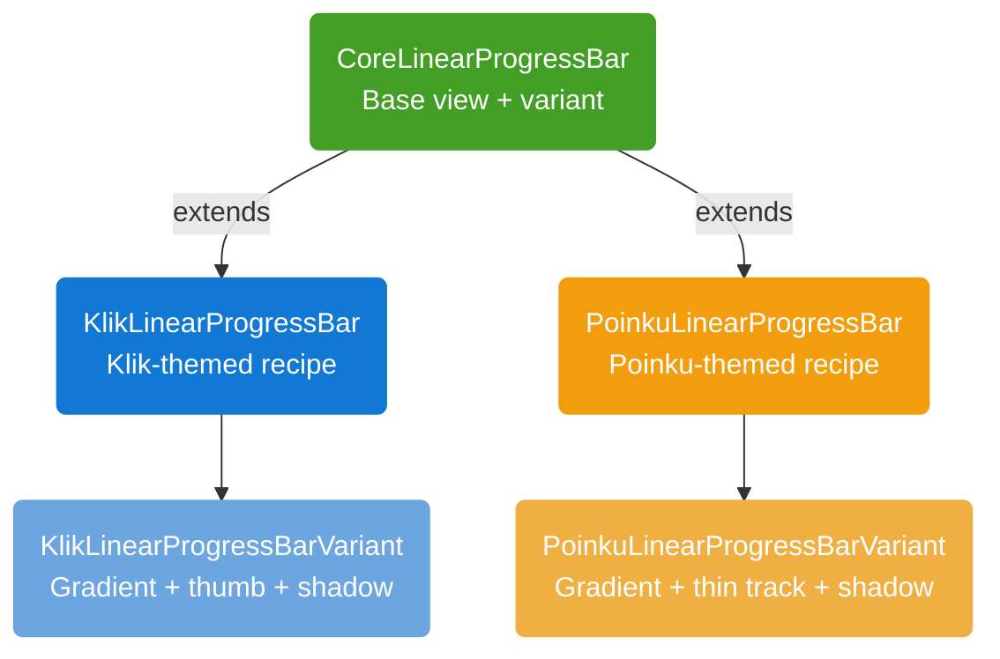
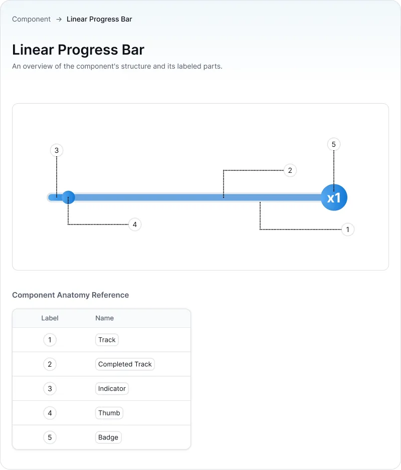
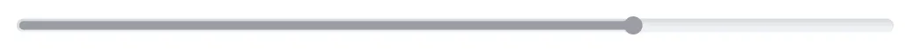

feat:# Linear Progress Bar

`LinearProgressBar` is a customizable Android custom `View` for displaying progress of single or multi lap progress and both determinate and indeterminate (loading) states, making it suitable for a wide range of progress-tracking use cases across an app. Each product ships its own **recipe** — a themed subclass that passes a product-specific: **Klik** (`KlikLinearProgressBar`) and **Poinku** (`PoinkuLinearProgressBar`).

## Architecture



| Class                       | Role                                                                                                                                                           |
|-----------------------------|----------------------------------------------------------------------------------------------------------------------------------------------------------------|
| `LinearProgressBarVariant`  | Abstract class holding a product's defaults: track, indicator, thumb, completed layer, inner shadow, badge visibility, disabled colors and animation timing.   |
| `LinearProgressBarDelegate` | Listener interface notified on every frame of the progress animation.                                                                                          |
| `CoreTextBadge`             | The `xN` lap badge. It is a separate component placed inside the progress bar and is configured on its own through the `badge` property (see [Badge](#badge)). |




`CoreLinearProgressBar` is composed of the following visual parts:

| Part               | Description                                                                                                                | Related properties                                                                                    |
|--------------------|----------------------------------------------------------------------------------------------------------------------------|-------------------------------------------------------------------------------------------------------|
| **Track**          | The full-width background pill the indicator moves across.                                                                 | `trackColor`, `trackThickness`, `trackCornerRadius`, `trackPadding`, `setTrackGradient()`             |
| **Indicator**      | The filled segment representing current progress within the active lap, inset from the track edges.                        | `indicatorColor`, `indicatorPadding`, `setIndicatorGradient()`                                        |
| **Thumb**          | The rounded handle that tracks the indicator's leading edge; hides during loading and intermittent animation.              | `thumbSize`, `thumbColor`, `thumbCornerRadius`, `showThumb`, `setThumbGradient()`                     |
| **Badge**          | The `x{N}` pill showing how many laps have completed so far.                                                               | `showBadge`, `badgeCount` (auto-managed), `badge`                                                     |
| **Completed fill** | Replaces the indicator across the *entire* track once a lap finishes, before the indicator resets and starts the next lap. | `completedIndicatorColor`, `showCompletedIndicator`, `setCompletedIndicatorGradient()`                |
| **Inner shadow**   | A soft shadow drawn inside the track.                                                                                      | `showInnerShadow`, `innerShadowColor`, `innerShadowOffsetX/Y`, `innerShadowBlur`, `innerShadowSpread` |

### Preview

| State                        | Visual                                                                                                                                    | Description                                                                                                                                     |
|------------------------------|-------------------------------------------------------------------------------------------------------------------------------------------|-------------------------------------------------------------------------------------------------------------------------------------------------|
| **Default**                  |                                  | The progress bar is in its default state and animates to each new `indicatorProgress`.                                                          |
| **Disabled**                 |                                                                               | The progress bar is disabled, does not respond to user input, and does not animate — progress changes are applied instantly with no transition. |
| **Multi Lap**                |               | Progress beyond `maxIndicatorProgress` wraps into laps, and the badge counts the completed ones.                                                |
| **Loading**                  |                   | The thumb scales out while loading and scales back in when loading finishes.                                                                    |
| **Intermittent Fixed Width** |  | A segment one third of the track wide slides from left to right and loops.                                                                      |
| **Intermittent Stretch**     |          | A segment grows from the left edge to fill the track, then clears toward the right edge.                                                        |

## CoreLinearProgressBar

### Features

- **Debounced, animated progress**: `indicatorProgress` animates to its new value with an ease-in-out curve. Rapid changes are debounced (`progressAnimationDelay`, 300 ms by default) before animating, which avoids janky animation stacking. When `shouldAnimate` is off or the view is disabled, the value is applied instantly.
- **Lap-based progress**: progress values can exceed `maxIndicatorProgress`, wrapping into "laps." Each completed lap increments an automatic badge counter and leaves a "completed" layer behind.
- **Loading state handling**: `setLoadingStarted()` / `setLoadingFinished()` temporarily hide the thumb during async operations.
- **Indeterminate ("intermittent") mode**: two animation styles for when progress is unknown — `FIXED_WIDTH` (a sliding block) and `STRETCH` (a growing/shrinking segment).
- **Thumb and inner shadow**: an optional thumb at the leading edge of the indicator and an optional inner shadow with configurable offset, blur and spread.
- **Solid or gradient fills**: track, indicator, thumb and completed layer accept either a solid color or a gradient.
- **Disabled state handling**: disabling the view swaps in the variant's disabled colors and drops gradients, without extra code.
- **XML attribute and style support**: nearly all visual properties can be configured from XML layouts and styles (gradients, disabled colors and animation timing are code-only).
- **Extensible**: new products add a variant and a themed subclass without modifying `CoreLinearProgressBar`.

### Properties

Default values are those of `DefaultLinearProgressBarVariant`. Product recipes override them (see [Klik](#klik-linear-progress-bar) and [Poinku](#poinku-linear-progress-bar)).

**Progress**

| Property                    | Type                         | Default Value          | Description                                                                                                                          |
|-----------------------------|------------------------------|------------------------|--------------------------------------------------------------------------------------------------------------------------------------|
| `indicatorProgress`         | `Float`                      | `0f`                   | Target progress, clamped to `0..progressLimit`. Animates from `currentProgress`. Starting it stops a running intermittent animation. |
| `currentProgress`           | `Float` *(read-only)*        | `0f`                   | The value currently drawn (animated). `indicatorProgress` is the value the bar is heading to.                                        |
| `maxIndicatorProgress`      | `Float`                      | `100f`                 | The value at which one lap of the indicator is full. Minimum `1f`.                                                                   |
| `progressLimit`             | `Float`                      | `maxIndicatorProgress` | Total progress the bar can reach. Defaults to a single lap; set it to a multiple of `maxIndicatorProgress` for multi-lap.            |
| `shouldAnimate`             | `Boolean`                    | `true`                 | When `false`, `indicatorProgress` is applied immediately instead of animating.                                                       |
| `progressAnimationDuration` | `Long`                       | `800` (ms)             | Duration of the progress animation. Comes from the variant's `animationDurationMs`.                                                  |
| `progressAnimationDelay`    | `Long`                       | `300` (ms)             | Delay before the progress animation starts. Comes from the variant's `animationDelayMs`.                                             |
| `isIntermittentRunning`     | `Boolean` *(read-only)*      | `false`                | Whether the intermittent animation is running.                                                                                       |
| `delegate`                  | `LinearProgressBarDelegate?` | `null`                 | Receives progress animation updates (see [Delegate](#delegate)).                                                                     |

**Track and indicator**

| Property             | Type                | Default Value                       | Description                                                                          |
|----------------------|---------------------|-------------------------------------|--------------------------------------------------------------------------------------|
| `trackColor`         | `Int` (`@ColorInt`) | `R.color.black_20`                  | Track color. Clears any track gradient when set.                                     |
| `trackThickness`     | `Float`             | `6` (dp)                            | Track thickness, in px.                                                              |
| `trackCornerRadius`  | `Float`             | `trackThickness / 2` (pill)         | Track corner radius, in px.                                                          |
| `trackPadding`       | `Float`             | `0` (dp)                            | Padding around the track, in px.                                                     |
| `indicatorColor`     | `Int` (`@ColorInt`) | `R.color.primary_30`                | Indicator color. Clears any indicator gradient when set.                             |
| `indicatorPadding`   | `Float`             | `1` (dp)                            | Gap between the track edge and the indicator, in px.                                 |

**Completed layer**

| Property                  | Type                | Default Value        | Description                                                                                                        |
|---------------------------|---------------------|----------------------|--------------------------------------------------------------------------------------------------------------------|
| `completedIndicatorColor` | `Int` (`@ColorInt`) | `R.color.primary_10` | Color of the layer left behind by finished laps. Clears any completed-layer gradient when set.                     |
| `showCompletedIndicator`  | `Boolean`           | `false`              | Managed automatically: it turns on once at least one lap is completed and off again when progress drops below one. |

**Thumb**

| Property            | Type                | Default Value        | Description                                                         |
|---------------------|---------------------|----------------------|---------------------------------------------------------------------|
| `showThumb`         | `Boolean`           | `false`              | Shows or hides the thumb at the end of the indicator.               |
| `thumbSize`         | `Float`             | `R.dimen.xxs`        | Thumb diameter, in px.                                              |
| `thumbCornerRadius` | `Float`             | `thumbSize / 2`      | Thumb corner radius, in px.                                         |
| `thumbColor`        | `Int` (`@ColorInt`) | `R.color.primary_30` | Thumb color. Clears any thumb gradient when set.                    |

**Inner shadow**

| Property             | Type                | Default Value                        | Description                                                 |
|----------------------|---------------------|--------------------------------------|-------------------------------------------------------------|
| `showInnerShadow`    | `Boolean`           | `false`                              | Shows or hides the inner shadow.                            |
| `innerShadowColor`   | `Int` (`@ColorInt`) | `R.color.progress_bar_black_opacity` | Shadow color.                                               |
| `innerShadowOffsetX` | `Float`             | `1` (dp)                             | Horizontal offset. Set in dp; the value read back is in px. |
| `innerShadowOffsetY` | `Float`             | `2` (dp)                             | Vertical offset. Set in dp; the value read back is in px.   |
| `innerShadowBlur`    | `Float`             | `5`                                  | Blur radius, in px. `0` disables the blur.                  |
| `innerShadowSpread`  | `Float`             | `0` (dp)                             | Spread. Set in dp; the value read back is in px.            |

**Badge**

| Property     | Type            | Default Value | Description                                                                                         |
|--------------|-----------------|---------------|-----------------------------------------------------------------------------------------------------|
| `showBadge`  | `Boolean`       | `false`       | Shows or hides the `xN` lap badge and reserves space for it in the measured height.                 |
| `badgeCount` | `Int`           | `0`           | Number of completed laps shown in the badge. Managed automatically from `currentProgress`.          |
| `badge`      | `CoreTextBadge` | default badge | The badge component. Replace or configure it directly (see [Badge](#badge)).                        |

### Methods

| Method                                                                                                    | Description                                                                                                                     |
|-----------------------------------------------------------------------------------------------------------|---------------------------------------------------------------------------------------------------------------------------------|
| `setIndicatorGradient(colors: IntArray, orientation: GradientDrawable.Orientation = LEFT_RIGHT)`          | Applies a gradient to the indicator, replacing any solid `indicatorColor`.                                                      |
| `setTrackGradient(colors: IntArray, orientation: GradientDrawable.Orientation = LEFT_RIGHT)`              | Applies a gradient to the track, replacing any solid `trackColor`.                                                              |
| `setThumbGradient(colors: IntArray, orientation: GradientDrawable.Orientation = LEFT_RIGHT)`              | Applies a gradient to the thumb, replacing any solid `thumbColor`. The badge background follows the thumb colors.               |
| `setCompletedIndicatorGradient(colors: IntArray, orientation: GradientDrawable.Orientation = LEFT_RIGHT)` | Applies a gradient to the completed layer.                                                                                      |
| `startIntermittentAnimation(mode: IntermittentMode = <last mode>)`                                        | Starts the indeterminate animation and cancels any running progress animation.                                                  |
| `stopIntermittentAnimation()`                                                                             | Stops the indeterminate animation. Setting `indicatorProgress` does this automatically.                                         |
| `setLoadingStarted()`                                                                                     | Puts the bar in a loading state: the thumb scales away and stays hidden while progress updates.                                 |
| `setLoadingFinished()`                                                                                    | Ends the loading state and brings the thumb back. If a progress animation is still running, the thumb returns once it finishes. |

The gradient setters take resolved colors (`@ColorInt`), not color resource ids. Gradient colors are used while the view is enabled; a disabled bar always draws the variant's solid disabled colors.

**`IntermittentMode`**

| Mode          | Behavior                                                                                                                        |
|---------------|---------------------------------------------------------------------------------------------------------------------------------|
| `FIXED_WIDTH` | A segment one third of the track wide slides across it from left to right. Linear, 2.1 s per loop.                              |
| `STRETCH`     | The indicator grows from the left edge to fill the track, then shrinks away toward the right edge. Ease in-out, 1.4 s per loop. |

### Delegate

`LinearProgressBarDelegate` reports every frame of the progress animation.

```kotlin
interface LinearProgressBarDelegate {
    fun onAnimationUpdateListener(progressBar: CoreLinearProgressBar, animatedValue: Float, targetProgress: Float)
}
```

| Parameter        | Description                                                                                                                                    |
|------------------|------------------------------------------------------------------------------------------------------------------------------------------------|
| `progressBar`    | The bar that is animating.                                                                                                                     |
| `animatedValue`  | The value currently drawn.                                                                                                                     |
| `targetProgress` | The value the current animation segment is heading to. When progress crosses a lap, this is the end of the lap before the next segment starts. |

### Badge

The `xN` lap badge is a regular `CoreTextBadge` exposed through the `badge` property, so it is styled and configured like any other text badge rather than through the progress bar or its variant. The progress bar only controls whether the badge is shown (`showBadge`), what it says (the number of completed laps), and its background, which follows the thumb colors (or the disabled thumb color when the bar is disabled).

For the badge's full list of properties, methods, XML attributes and variants, see the [Text Badge](TextBadge.md) documentation.

By default the badge uses the `TextAppearance.Inter.Bold.TextBadge` text appearance and a minimum height of `R.dimen.s`. To change its look:

```kotlin
progressBar.badge.textColor = context.color(R.color.white)
progressBar.badge.minimumHeight = 24.dp.toInt()   // px; use any size you need
```

Note that the badge background is refreshed when the view is created and when it is enabled or disabled, not when the thumb color changes afterwards.

### Variant Fields

`LinearProgressBarVariant` is the code-level source of a product's defaults. The last column shows whether the same value can be overridden from XML.

| Field                                                | Default                              | XML Attribute                              |
|------------------------------------------------------|--------------------------------------|--------------------------------------------|
| `trackThickness`                                     | `6f` (dp)                            | `trackThickness`                           |
| `trackCornerRadius`                                  | `null` (pill)                        | `trackCornerRadius`                        |
| `trackPadding`                                       | `0f` (dp)                            | `trackPadding`                             |
| `indicatorPadding`                                   | `1f` (dp)                            | `indicatorPadding`                         |
| `trackColorRes`                                      | `R.color.black_20`                   | `trackColor`                               |
| `indicatorColorRes`                                  | `R.color.primary_30`                 | `indicatorColor`                           |
| `indicatorGradient`, `gradientOrientation`           | `null`, `LEFT_RIGHT`                 | — (code only)                              |
| `disabledTrackColorRes`, `disabledIndicatorColorRes` | `black_20`, `black_40`               | — (code only)                              |
| `showThumb`                                          | `false`                              | `showThumb`                                |
| `thumbSizeRes`                                       | `R.dimen.xxs`                        | `thumbSize`                                |
| `thumbColorRes`                                      | `R.color.primary_30`                 | `thumbColor`                               |
| `thumbGradient`                                      | `null`                               | — (code only)                              |
| `disabledThumbColorRes`                              | `R.color.black_40`                   | — (code only)                              |
| `completedColorRes`                                  | `R.color.primary_10`                 | `completedIndicatorColor`                  |
| `disabledCompletedColorRes`                          | `R.color.black_30`                   | — (code only)                              |
| `showInnerShadow`                                    | `false`                              | — (see note below)                         |
| `innerShadowColorRes`                                | `R.color.progress_bar_black_opacity` | `innerShadowColor`                         |
| `disabledInnerShadowColorRes`                        | `R.color.progress_bar_black_opacity` | — (code only)                              |
| `innerShadowOffsetX`, `innerShadowOffsetY`           | `1f`, `2f` (dp)                      | `innerShadowOffsetX`, `innerShadowOffsetY` |
| `innerShadowBlur`                                    | `5f`                                 | `innerShadowBlur`                          |
| `innerShadowSpread`                                  | `0f` (dp)                            | `innerShadowSpread`                        |
| `showBadge`                                          | `false`                              | `showBadge`                                |
| `animationDurationMs`, `animationDelayMs`            | `800L`, `300L`                       | — (code only)                              |

### XML Attributes

| Attribute                 | Type                | Description                                                                                                                               |
|---------------------------|---------------------|-------------------------------------------------------------------------------------------------------------------------------------------|
| `linearProgressBarStyle`  | `reference (style)` | Theme attribute that points to the recipe style. Set by each product's `ThemeOverlay`; defaults to `Widget.EDTS.UIKit.LinearProgressBar`. |
| `indicatorProgress`       | `float`             | Initial progress. Applied once the view is inflated.                                                                                      |
| `maxIndicatorProgress`    | `float`             | Value at which one lap is full.                                                                                                           |
| `progressLimit`           | `float`             | Total progress the bar can reach. Defaults to `maxIndicatorProgress`.                                                                     |
| `shouldAnimate`           | `boolean`           | Animates progress changes.                                                                                                                |
| `trackColor`              | `color`             | Track color.                                                                                                                              |
| `trackThickness`          | `dimension`         | Track thickness.                                                                                                                          |
| `trackCornerRadius`       | `dimension`         | Track corner radius. When not set, the track is a pill (`trackThickness / 2`).                                                            |
| `trackPadding`            | `dimension`         | Padding around the track.                                                                                                                 |
| `indicatorColor`          | `color`             | Solid indicator color. Replaces the variant's indicator gradient.                                                                         |
| `indicatorPadding`        | `dimension`         | Gap between the track edge and the indicator.                                                                                             |
| `completedIndicatorColor` | `color`             | Color of the completed layer.                                                                                                             |
| `showCompletedIndicator`  | `boolean`           | Shows the completed layer. Also updated automatically as laps complete.                                                                   |
| `showThumb`               | `boolean`           | Shows or hides the thumb.                                                                                                                 |
| `thumbSize`               | `dimension`         | Thumb diameter.                                                                                                                           |
| `thumbCornerRadius`       | `dimension`         | Thumb corner radius. When not set, it is `thumbSize / 2`.                                                                                 |
| `thumbColor`              | `color`             | Solid thumb color. Replaces the variant's thumb gradient.                                                                                 |
| `innerShadowColor`        | `color`             | Inner shadow color.                                                                                                                       |
| `innerShadowOffsetX`      | `float` (dp)        | Inner shadow horizontal offset.                                                                                                           |
| `innerShadowOffsetY`      | `float` (dp)        | Inner shadow vertical offset.                                                                                                             |
| `innerShadowBlur`         | `float` (px)        | Inner shadow blur radius.                                                                                                                 |
| `innerShadowSpread`       | `float` (dp)        | Inner shadow spread.                                                                                                                      |
| `showBadge`               | `boolean`           | Shows or hides the lap badge.                                                                                                             |

> **Solid colors replace gradients:** `indicatorColor` and `thumbColor` set from XML replace the gradient that a product variant defines. Leave them out of styles that should keep the gradient.

#### Installation

Include a product recipe in your layout file:

```xml
<id.co.edtslib.uikit.recipes.linearprogressbar.klik.KlikLinearProgressBar
    android:id="@+id/linearProgressBar"
    android:layout_width="match_parent"
    android:layout_height="wrap_content"
    app:indicatorProgress="40"
    app:maxIndicatorProgress="100"
    app:progressLimit="500"
    app:trackThickness="6dp"
    app:thumbSize="16dp"
    app:showBadge="true"
    app:showThumb="true" />
```

#### Setup in Kotlin

```kotlin
val progressBar = findViewById<KlikLinearProgressBar>(R.id.linearProgressBar)

// Configure ranges
progressBar.maxIndicatorProgress = 100f   // value at which one "lap" completes
progressBar.progressLimit = 500f          // absolute ceiling across all laps

// Set progress (animates automatically)
progressBar.indicatorProgress = 40f

// Configure visuals
progressBar.trackColor = ContextCompat.getColor(this, R.color.black_20)
progressBar.showThumb = true
progressBar.showBadge = true

// Solid colors replace the product's gradient for that element
progressBar.indicatorColor = ContextCompat.getColor(this, R.color.primary_30)
progressBar.thumbColor = ContextCompat.getColor(this, R.color.primary_30)

// Setup delegate for per-frame animation callbacks
progressBar.delegate = object : LinearProgressBarDelegate {
    override fun onAnimationUpdateListener(
        progressBar: CoreLinearProgressBar,
        animatedValue: Float,
        targetProgress: Float,
    ) {
        // e.g. sync a percentage label with the animated value
        percentageLabel.text = "${animatedValue.toInt()}%"
    }
}
```

#### Multi-Lap Progress

`CoreLinearProgressBar` supports progress values greater than `maxIndicatorProgress`. When this happens:

- The visible indicator wraps back to `0` and animates again — a "lap."
- Each completed lap increments `badgeCount`, shown in the badge as `xN` when `showBadge` is on.
- Between laps, a brief cross-fade ("lap transition") plays as the completed-lap fill takes over before the indicator restarts.

```kotlin
// If maxIndicatorProgress = 100 and progressLimit = 500,
// setting indicatorProgress = 250 will animate through 2 completed laps
// and stop mid-way through the 3rd, with badgeCount ending at 2.
progressBar.maxIndicatorProgress = 100f
progressBar.progressLimit = 500f
progressBar.showBadge = true
progressBar.indicatorProgress = 250f
```

This is intended for use cases like repeatable streaks or multi-stage tasks, where a single 0–100% bar isn't enough to represent overall progress.

#### Loading State

Use `setLoadingStarted()` / `setLoadingFinished()` to temporarily hide the thumb while an indeterminate or async operation is in flight, without disturbing the underlying `indicatorProgress` value:

```kotlin
progressBar.setLoadingStarted()   // thumb scales out
// ... perform async work ...
progressBar.setLoadingFinished()  // thumb scales back in (or applies any pending progress first)
```

#### Intermittent (Indeterminate) Animation

When progress is indeterminate, use the intermittent animation instead of a fixed value:

```kotlin
// A sliding block that loops across the track
progressBar.startIntermittentAnimation(CoreLinearProgressBar.IntermittentMode.FIXED_WIDTH)

// A segment that grows then shrinks, worm-style
progressBar.startIntermittentAnimation(CoreLinearProgressBar.IntermittentMode.STRETCH)

// Stop and return control to indicatorProgress
progressBar.stopIntermittentAnimation()
```

**Fixed Width mode:** a fixed-width segment (1/3 of the track) slides continuously from left to right, looping back to the start once it reaches the end. Duration: **2100 ms**.


**Stretch mode:** a segment grows from the left edge to fill the track, then its left edge catches up to the right edge to clear it — a worm-like motion. Duration: **1400 ms**.


> While intermittent animation is running, the thumb and badge are hidden, and setting `indicatorProgress` will automatically stop it.

#### Solid Colors vs. Gradients

Each colorable element — indicator, track, thumb, and completed-lap fill — supports either a solid color or a gradient, but not both at once. Setting one clears the other for that element:

- Setting a solid color property (`indicatorColor`, `trackColor`, `thumbColor`, `completedIndicatorColor`) clears any gradient previously set on that element. This includes gradients that come from a product variant, so setting `indicatorColor` on a Klik bar replaces its blue gradient with a solid color.
- Calling a gradient setter (`setIndicatorGradient()`, `setTrackGradient()`, `setThumbGradient()`, `setCompletedIndicatorGradient()`) overrides the solid color for that element. Gradients accept 2+ colors and a `GradientDrawable.Orientation`.
- XML attributes only support solid colors — gradients must come from the variant or be set programmatically, since there's no XML attribute for multi-color gradients.
- When the view is disabled, gradients are ignored entirely in favor of the variant's flat disabled colors, regardless of what was set while enabled.

#### Programmatic Updates

```kotlin
// Update progress (animated)
progressBar.indicatorProgress = 75f

// Disable animation for the next update only
progressBar.shouldAnimate = false
progressBar.indicatorProgress = 20f
progressBar.shouldAnimate = true

// Solid color updates
progressBar.trackColor = Color.parseColor("#E0E0E0")
progressBar.thumbColor = Color.parseColor("#1178D4")

// Gradient updates
progressBar.setIndicatorGradient(
    intArrayOf(Color.parseColor("#58AAF3"), Color.parseColor("#1178D4"))
)
progressBar.setCompletedIndicatorGradient(
    intArrayOf(Color.parseColor("#A0D8FF"), Color.parseColor("#58AAF3"))
)

// Toggle elements
progressBar.showThumb = false
progressBar.showBadge = false
```

#### Customizing from XML

Extend the product's recipe style and apply it with `style=`:

```xml
<style name="Widget.App.LinearProgressBar.Thick" parent="Widget.EDTS.UIKit.LinearProgressBar.Klik">
    <item name="trackThickness">10dp</item>
    <item name="showBadge">true</item>
</style>
```

```xml
<id.co.edtslib.uikit.recipes.linearprogressbar.klik.KlikLinearProgressBar
    style="@style/Widget.App.LinearProgressBar.Thick"
    android:layout_width="match_parent"
    android:layout_height="wrap_content" />
```

#### Disabled State

To disable the bar and let the variant's disabled colors take over automatically:

```kotlin
progressBar.isEnabled = false
```

A disabled bar applies progress immediately instead of animating.

#### Layout

The bar takes the width its parent offers. Its height is always computed from its content: the tallest of the track (thickness plus padding), the thumb (when shown) and the badge (when shown). `layout_height` has no effect, so use `wrap_content`.

`onFinishInflate`, `onDetachedFromWindow`, `setEnabled`, `onMeasure` and `onDraw` are `final` in `CoreLinearProgressBar`, so recipes customize the bar through the variant and styles, not by overriding them.

#### Full Example

```kotlin
class TaskProgressActivity : AppCompatActivity() {
    private lateinit var binding: ActivityTaskProgressBinding

    override fun onCreate(savedInstanceState: Bundle?) {
        super.onCreate(savedInstanceState)
        binding = ActivityTaskProgressBinding.inflate(layoutInflater)
        setContentView(binding.root)

        setupProgressBar()
        loadTaskData()
    }

    private fun setupProgressBar() {
        binding.linearProgressBar.apply {
            maxIndicatorProgress = 100f
            progressLimit = 1000f

            setIndicatorGradient(
                intArrayOf(Color.parseColor("#58AAF3"), Color.parseColor("#1178D4")),
                GradientDrawable.Orientation.LEFT_RIGHT
            )

            delegate = object : LinearProgressBarDelegate {
                override fun onAnimationUpdateListener(
                    progressBar: CoreLinearProgressBar,
                    animatedValue: Float,
                    targetProgress: Float,
                ) {
                    binding.progressLabel.text = "${animatedValue.toInt()} pts"
                }
            }
        }
    }

    private fun loadTaskData() {
        binding.linearProgressBar.startIntermittentAnimation()

        viewModel.fetchProgress { totalPoints ->
            binding.linearProgressBar.stopIntermittentAnimation()
            binding.linearProgressBar.indicatorProgress = totalPoints
        }
    }
}
```

## Klik Linear Progress Bar

`KlikLinearProgressBar` uses a light-blue to dark-blue horizontal gradient for the indicator, shows a thumb with the same gradient, and draws a soft inner shadow on a 6dp track. The lap badge is off by default.

| Item                 | Value                                                           |
|----------------------|-----------------------------------------------------------------|
| **Recipe class**     | `KlikLinearProgressBar`                                         |
| **Style resource**   | `Widget.EDTS.UIKit.LinearProgressBar.Klik`                      |
| **Theme overlay**    | `ThemeOverlay.EDTS.UIKit.LinearProgressBar.Klik`                |
| **Kotlin variant**   | `KlikLinearProgressBarVariant`                                  |

| Part             | Enabled                                                                                   | Disabled             |
|------------------|-------------------------------------------------------------------------------------------|----------------------|
| **Track**        | `6dp` thick, `black_20`, no padding                                                       | `black_20`           |
| **Indicator**    | Gradient `progress_bar_light_blue` → `progress_bar_dark_blue` (`LEFT_RIGHT`), `1dp` padding | `black_40`           |
| **Thumb**        | Shown, size `R.dimen.xxs`, same gradient as the indicator                                 | `black_40`           |
| **Completed**    | `primary_10`                                                                              | `black_30`           |
| **Inner shadow** | `progress_bar_black_opacity`, offset `1dp / 2dp`, blur `5`, spread `0dp`                  | `progress_bar_black_opacity` |
| **Badge**        | Hidden                                                                                    | —                    |

**Implementation**:
```xml
<id.co.edtslib.uikit.recipes.linearprogressbar.klik.KlikLinearProgressBar
    android:id="@+id/progressKlik"
    android:layout_width="match_parent"
    android:layout_height="wrap_content"
    app:indicatorProgress="40" />
```
Or drive it at runtime:
```kotlin
progressKlik.progressLimit = 400f
progressKlik.showBadge = true
progressKlik.indicatorProgress += 40f
```

## Poinku Linear Progress Bar

`PoinkuLinearProgressBar` uses a thinner 4dp track on a white background, with the indicator gradient running diagonally (`BL_TR`). The thumb and the lap badge are off by default, and the inner shadow is tighter and inverted (negative offset).

| Item                 | Value                                                            |
|----------------------|------------------------------------------------------------------|
| **Recipe class**     | `PoinkuLinearProgressBar`                                        |
| **Style resource**   | `Widget.EDTS.UIKit.LinearProgressBar.Poinku`                     |
| **Theme overlay**    | `ThemeOverlay.EDTS.UIKit.LinearProgressBar.Poinku`               |
| **Kotlin variant**   | `PoinkuLinearProgressBarVariant`                                 |

| Part             | Enabled                                                                                              | Disabled                     |
|------------------|------------------------------------------------------------------------------------------------------|------------------------------|
| **Track**        | `4dp` thick, `poinku_color_neutral_white`, no padding                                                | `poinku_color_grey_20`       |
| **Indicator**    | Gradient `poinku_color_progress_bar_light_blue` → `poinku_color_progress_bar_dark_blue` (`BL_TR`), no padding | `poinku_color_grey_50`       |
| **Thumb**        | Hidden by default (`poinku_color_primary_blue_30`, same gradient as the indicator when shown)        | `poinku_color_grey_50`       |
| **Completed**    | `poinku_color_primary_blue_10`                                                                       | `poinku_color_grey_30`       |
| **Inner shadow** | `poinku_color_progress_bar_black_opacity`, offset `-0.5dp / -0.5dp`, blur `4`, spread `1dp`          | `poinku_color_progress_bar_black_opacity` |
| **Badge**        | Hidden                                                                                               | —                            |

**Implementation**:
```xml
<id.co.edtslib.uikit.recipes.linearprogressbar.poinku.PoinkuLinearProgressBar
    android:id="@+id/progressPoinku"
    android:layout_width="match_parent"
    android:layout_height="wrap_content"
    app:indicatorProgress="60" />
```
Or drive it at runtime:
```kotlin
progressPoinku.indicatorProgress += 40f
progressPoinku.startIntermittentAnimation(CoreLinearProgressBar.IntermittentMode.STRETCH)
```