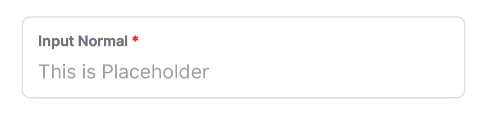
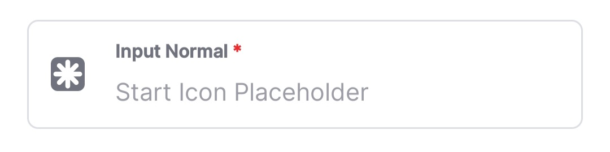
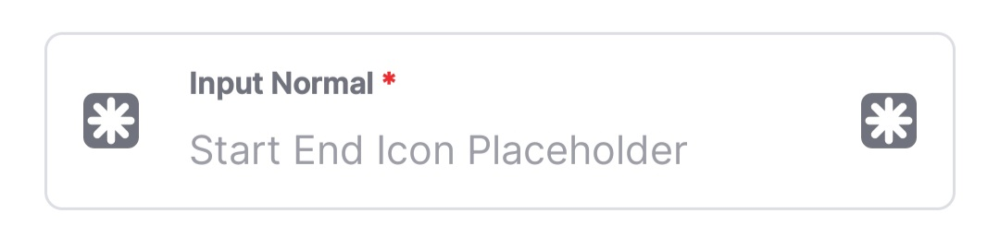
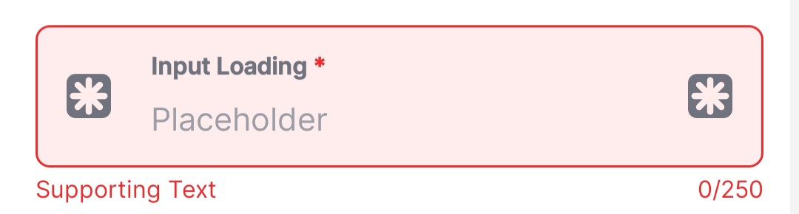
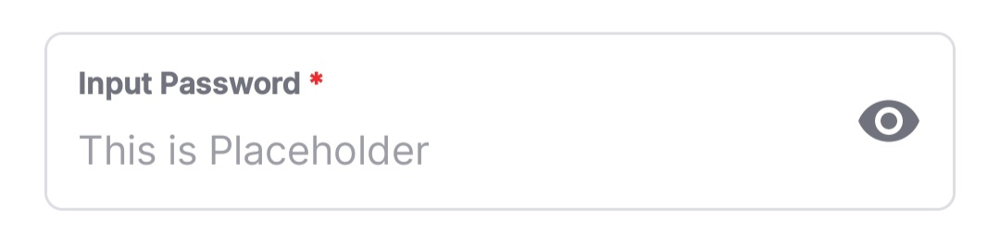
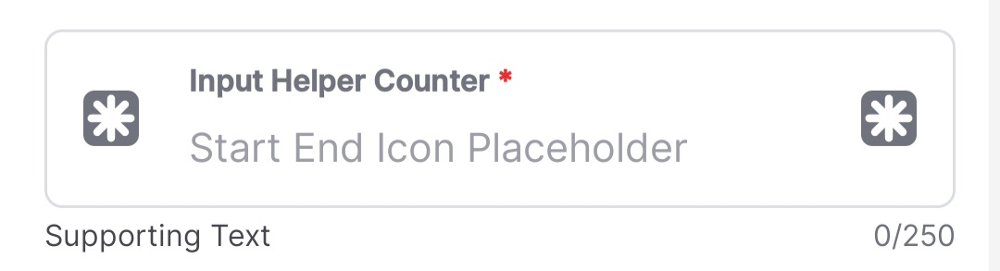
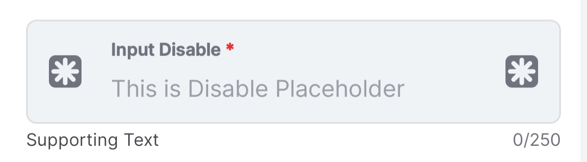
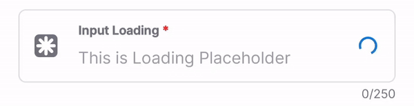

# TextField

Use `KlikTextField` or `PoinkuTextField` for a single-line input with product styling. Both share `CoreTextField`. The base component provides the same editing API with a neutral recipe.

| Entry point | Label | Input | Supporting text and counter | Focused stroke |
| --- | --- | --- | --- | --- |
| `KlikTextField` | Inter Semibold 12sp | Inter Regular 16sp | Inter Regular 12sp | `klik_color_blue_30` |
| `PoinkuTextField` | Rubik Semibold 12sp | Rubik Regular 14sp | Rubik Regular 10sp | `poinku_color_primary_blue_30` |

The label remains inside the field when text is present. Focus comes from the native editor. Set `errorText` to show an error and `null` or an empty string to restore the supporting text. Set `isEnabled` to disable editing and trailing actions.

## Try the sample

Open **Configure** in the TextField guide to edit the preview's label, value, placeholder, supporting text, error, icons, required state, enabled state, counter, maximum length, and keyboard options. Select an icon from the bundled catalog or choose **None**. Enable **Clear text action** and supply an action description to make the trailing icon clear the value.

Configuration applies live to the editable preview. Reference examples show the product states below it. Each product retains its own configuration across product switches and recreation. **Reset configuration** restores the selected product's defaults.

Poinku password inputs can use the visibility toggle, which takes over the trailing slot. Choose Legacy to try the existing password field and legacy API behavior.

## XML

```xml
<id.co.edtslib.uikit.recipes.textfield.klik.KlikTextField
    android:id="@+id/tfEmail"
    android:layout_width="match_parent"
    android:layout_height="wrap_content"
    android:autofillHints="emailAddress"
    android:hint="@string/email_placeholder"
    android:imeOptions="actionDone"
    android:inputType="textEmailAddress"
    app:fieldCounterEnabled="true"
    app:fieldLabel="@string/email_label"
    app:fieldMaxLength="50"
    app:fieldSupportingText="@string/email_help"
    app:isFieldRequired="true" />
```

Use `app:fieldStartIcon` and `app:fieldEndIcon` for optional drawables. Supply a content description with `setEndIconAction(description, action)` to make the trailing icon actionable. The counter appears when `fieldCounterEnabled` is true and `fieldMaxLength` is positive.

For a Poinku password, use `PoinkuTextField` with `android:inputType="textPassword"`. Add `app:fieldPasswordToggleEnabled="true"` to expose the visibility toggle in the trailing slot. That slot displays the password toggle while enabled.

## Kotlin and migration

```kotlin
binding.tfEmail.setOnTextChangedListener { value ->
    binding.tfEmail.errorText = if (value.isBlank()) {
        getString(R.string.email_required)
    } else {
        null
    }
}
```

| Legacy single-line field | Product recipe |
| --- | --- |
| `android:hint` as the label | `app:fieldLabel` |
| `app:placeholderText` | `android:hint` |
| `app:fieldInputType` / `app:fieldImeOptions` | `android:inputType` / `android:imeOptions` |
| `app:startIconDrawable` / `app:endIconDrawable` | `app:fieldStartIcon` / `app:fieldEndIcon` |
| `app:helperText` / `app:counterEnabled` | `app:fieldSupportingText` / `app:fieldCounterEnabled` |
| `editText?.text` / `TextFieldDelegate.onValueChange` | `text` / `setOnTextChangedListener` |
| `error` | `errorText` |

Use the legacy entry point for existing style overrides, loading and success states, Klik passwords, and fields that rely on direct `editText` access. Use [OtpGroup](OtpGroup.md) for segmented input.

## Legacy TextField reference

`TextField` is a custom text input component extending Android's `TextInputLayout`. It provides built-in validation, error handling, and customizable input types for a flexible user experience.

* * * * *

Overview
--------

Built on Material Design's `TextInputLayout`, `TextField` wraps a `TextInputEditText` and supports:

-   Error handling with animations and haptic feedback

-   Configurable maximum character lengths

-   Dynamic hint modification for required fields (adds `*` to hint)

-   Delegated callbacks for text changes

* * * * *

Common Use Cases
----------------

Example XML: [Source Code](https://github.com/shidiq-uxe/edts-ui-kit/blob/main/app/src/main/res/layout/activity_textfield.xml)

1.  **Standard Input**\
    

2.  **Start Icon Input**\
    

3.  **Start & End Icons**\
    

4.  **Error State**\
    

5.  **Password Input** (visibility toggle)\
    

6.  **Helper Text & Character Counter**\
    

7.  **Disabled Input**\
    

8.  **Loading State**\
    

* * * * *

Features
--------

### Input Types (`InputType` enum)

-   `Text`, `Password`, `Pin`, `Phone`, `Email`, `OTP`

### IME Options (`ImeOption` enum)

-   `Next`, `Send`, `Search`, `Done`

### Other Features

-   **Error Handling:** Automatically updates styling, triggers haptic feedback

-   **Text Change Delegate:** Listens for changes via `delegate`

-   **Max Length Filtering:** Enforces character limits dynamically

* * * * *

Usage
-----

### XML Integration

```xml
<id.co.edtslib.uikit.textfield.TextField
    android:layout_width="match_parent"
    android:layout_height="wrap_content"
    android:hint="Input Normal"
    app:placeholderText="Start End Icon Placeholder"
    app:startIconDrawable="@drawable/ic_placeholder_medium_24"
    app:endIconDrawable="@drawable/ic_placeholder_medium_24"
    app:endIconMode="custom" />
```

### Programmatic Usage (Kotlin)

```kotlin
val textField = binding.tfInput.apply {
    delegate = object : TextFieldDelegate {
        override fun onValueChange(value: String?) {
            println("New value: $value")
        }
    }
    inputType = TextField.InputType.Email
    imeOption = TextField.ImeOption.Done
    maxLength = 50
}
```

* * * * *

Custom Attributes
-----------------

| Attribute                          | Type    | Description                                   |
|------------------------------------|---------|-----------------------------------------------|
| `app:fieldInputType`               | Integer | Defines input type (`Text`, `Password`, etc.) |
| `app:fieldImeOptions`              | Integer | Sets IME action (`Next`, `Send`, etc.)        |
| `app:fieldMaxLength`               | Integer | Maximum character limit (0 to disable)        |
| `app:isFieldRequired`              | Boolean | Appends `*` to hint if true                   |
| `app/android:[MaterialAttributes]` | Various | Inherits Material Design attributes           |

* * * * *

Properties & Methods
--------------------

### Properties

-   `delegate: TextFieldDelegate?` → Listens for text changes

-   `isFieldRequired: Boolean` → Appends `*` to hint if true

-   `inputType: InputType` → Defines input behavior

-   `imeOption: ImeOption` → Sets IME action button

-   `maxLength: Int` → Limits character count

-   `textInputError: TextView?` → Access error text view

### Methods

-   `setError(errorText: CharSequence?)` → Updates error styling & triggers feedback

-   `isHelperTextEnabled(): Boolean` → Checks helper text visibility

* * * * *

Error Handling
--------------

When `setError` is called:

-   Changes helper text color

-   Enables error styling & flag

-   Updates text color for OTP inputs

-   Adjusts line height to fit design

-   Triggers haptic feedback

* * * * *

Customization & Styling
-----------------------

-   **Required Field Indicator**: Adds `*` to hints for mandatory fields

-   **Input Filters**: Applies/removes filters dynamically

-   **End Icon Behavior**: Toggles password visibility

-   **Dynamic Padding**: Adjusts padding based on errors

* * * * *

Notes & Requirements
--------------------

-   Customizable via properties while maintaining internal consistency

-   Follows Material Design guidelines for TextInputLayout